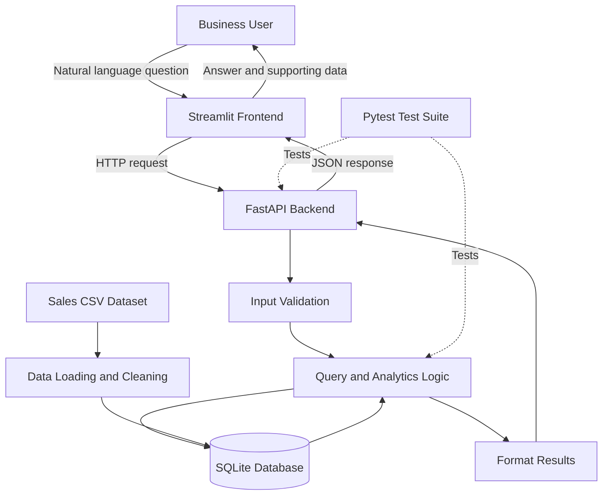

## System Architecture

The Streamlit interface collects business questions and sends them to the FastAPI backend. The backend validates inputs, processes the question using the implemented query and analytics logic, retrieves results from SQLite, and returns a structured response. The sales CSV is loaded and cleaned before being stored in the database. Automated tests verify the backend and analytics logic.
