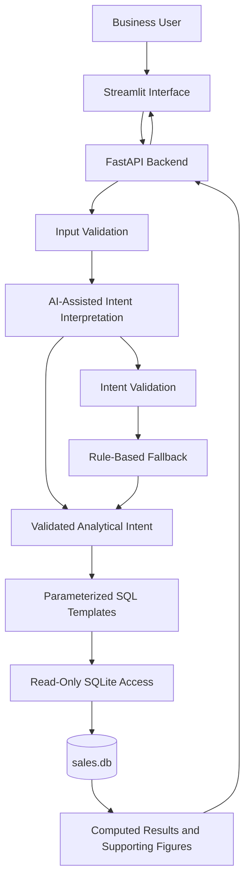

# Mini AI Business Intelligence Assistant

**AI-Assisted Development Challenge | GET Selection**

Ask business questions in plain English. Get answers backed by database queries, supporting figures, and explicit data-quality handling.

The Mini AI Business Intelligence Assistant transforms raw sales transactions into evidence-backed business insights. It combines natural-language question interpretation, deterministic analytics, a SQLite database, a FastAPI backend, and an interactive Streamlit interface.

The goal is not simply to generate an answer that sounds correct. **Every supported analytical answer must be grounded in computed results rather than invented figures.**

---

## Table of Contents

- [Overview](#overview)
- [Key Features](#key-features)
- [Example Business Questions](#example-business-questions)
- [System Architecture](#system-architecture)
- [Technology Stack](#technology-stack)
- [How It Works](#how-it-works)
- [Data Management and Quality](#data-management-and-quality)
- [AI Integration and Reliability](#ai-integration-and-reliability)
- [API Overview](#api-overview)
- [Project Structure](#project-structure)
- [Getting Started](#getting-started)
- [Running the Application](#running-the-application)
- [Testing](#testing)
- [Error Handling and Debugging](#error-handling-and-debugging)
- [Security and Reliability](#security-and-reliability)
- [Known Limitations](#known-limitations)
- [Development Report](#development-report)
- [Future Improvements](#future-improvements)

---

## Overview

Business users often need quick answers to questions about revenue, product performance, regional sales, and monthly trends. Traditional reporting may require writing SQL queries or navigating multiple dashboard filters.

This project provides a conversational interface that allows a user to ask questions in natural language and receive structured, data-backed responses.

### The problem

Given a sales transaction dataset, build an application that:

1. Imports and stores the supplied data in a database.
2. Accepts questions written in natural language.
3. Interprets supported questions using an AI-assisted mechanism.
4. Computes answers using deterministic database queries or equivalent logic.
5. Displays the answer along with relevant supporting figures.
6. Handles invalid questions, problematic records, and runtime errors safely.
7. Includes automated tests and reproducible setup instructions.

### The approach

The application separates **language understanding from numerical computation**.

The AI-assisted interpretation layer identifies the user's analytical intent. The backend then validates that intent and executes predefined, parameterized analytical queries against SQLite. This avoids relying on an LLM to perform financial arithmetic or invent data.

---

## Key Features

### 1. Natural-language analytics

Users can ask business questions without writing SQL manually. The application supports analytical intents such as total revenue, product rankings, regional performance, and monthly trends.

### 2. Database-backed answers

Analytical results are computed from the stored sales data using controlled SQL templates. The application can present the figures behind an answer so the user can understand how the result was obtained.

### 3. Data cleaning and validation

The data-loading workflow handles missing or invalid records, including incomplete prices, zero quantities, and returned transactions, according to the application's data-quality rules.

### 4. AI-assisted interpretation

The question interpretation mechanism uses structured intent output, validation, and a rule-based fallback when AI interpretation is unavailable or unsuitable.

### 5. Interactive user interface

The Streamlit interface provides a conversational entry point for business questions and displays the corresponding answers and supporting information.

### 6. REST API

FastAPI exposes endpoints for asking questions, checking service health, and inspecting data quality. Additional data-management functionality supports dataset operations.

### 7. Automated testing

The project includes a pytest suite covering supported analytics, invalid questions, edge cases, and important application behavior.

### 8. Safer query execution

The application uses controlled query templates, parameterized SQL, input validation, and read-only database protections to prevent analytical questions from becoming destructive database operations.

---

## Example Business Questions

The application is designed around the business scenarios specified in the challenge.

| Business question | Analytical operation |
|---|---|
| What is the total revenue? | Aggregate valid transaction revenue |
| Which product generated the highest revenue? | Group revenue by product and rank the results |
| What is the monthly revenue trend? | Aggregate revenue by month |
| Which region generated the highest sales? | Compare regional sales using a defined sales metric |
| How did revenue change between two months? | Compare monthly totals and calculate the absolute change |

The exact result depends on the records retained by the data-cleaning rules.

For revenue calculations, the intended formula is:

`Revenue = (Quantity × Unit Price) − Discount Amount`

The application must use a consistent definition of valid transactions and revenue across all analytical queries.

---

## System Architecture

The project follows a lightweight, layered architecture.



### Component responsibilities

| Component | Responsibility |
|---|---|
| Streamlit | Collects user questions and presents results |
| FastAPI | Exposes application functionality through HTTP endpoints |
| Question interpreter | Converts natural-language questions into structured analytical intent |
| Validation and fallback | Rejects unsupported interpretations and provides a controlled alternative where possible |
| Analytics layer | Maps supported intents to deterministic query logic |
| SQLite | Stores the sales data and executes analytical queries |
| Data-quality logic | Identifies or handles invalid, incomplete, and excluded records |
| Pytest | Verifies correctness and expected application behavior |

The architecture is intentionally small enough to understand, test, and modify within the challenge's three-to-four-hour target effort.

---

## Technology Stack

| Technology | Purpose |
|---|---|
| Python | Application logic and data processing |
| FastAPI | Backend REST API |
| Streamlit | Interactive user interface |
| SQLite | Lightweight relational database |
| SQL | Deterministic business analytics |
| LLM / AI-assisted interpretation | Natural-language intent extraction |
| Pytest | Automated testing |
| Pandas, where used in the data workflow | Tabular data processing |
| Uvicorn | ASGI server for the FastAPI application |

The database and analytics layers do not depend on the LLM to calculate numerical results.

---

## How It Works

The application's request flow is divided into six stages.

### Stage 1: Data ingestion

The supplied sales CSV is loaded from `data/sales.csv`.

The data-loading process reads the transaction fields, validates records, and prepares the data for storage in `data/sales.db`.

The implementation retains a raw-data representation and a cleaned-data representation through the `sales_raw` and `sales_clean` tables.

This separation helps preserve the original input while allowing analytical queries to operate on eligible records.

### Stage 2: Question submission

The user enters a question in the Streamlit interface.

For example:

> Which product generated the highest revenue?

The UI sends the question to the backend, where it is validated before further processing.

### Stage 3: Intent interpretation

The AI-assisted interpretation layer identifies the type of analysis requested.

For example, the question above corresponds to a product-revenue ranking operation.

The application uses structured intent output rather than treating arbitrary generated SQL as trusted executable code.

### Stage 4: Query selection and validation

The backend checks whether the interpreted intent is supported and maps it to an approved analytical operation.

Where interpretation fails or cannot be used, a rule-based fallback can handle recognized patterns. Unsupported questions should receive a controlled response instead of fabricated analytics.

### Stage 5: Deterministic computation

The analytics layer executes the corresponding parameterized SQL query against SQLite.

The query computes the result from stored transaction data, using the application's data-quality and revenue rules.

### Stage 6: Evidence-backed response

The backend returns the computed result in a structured response. The Streamlit interface displays the answer and relevant supporting figures.

This design makes the application easier to debug because the language interpretation, SQL execution, and presentation layers have distinct responsibilities.

---

## Data Management and Quality

The supplied dataset contains transaction identifiers, order dates, products, categories, regions, sales channels, quantities, unit prices, discounts, and transaction statuses.

### Database design

The application uses SQLite, stored locally at:

`data/sales.db`

The data workflow uses two logical representations:

- **`sales_raw`** — preserves the imported transaction records for inspection and data-quality handling.
- **`sales_clean`** — contains records eligible for analytical queries according to the cleaning rules.

The CSV is the input source, while SQLite provides the persistent data store used by the analytics layer.

### Data-quality rules

The supplied sample includes records that require special treatment.

| Example | Issue | Treatment |
|---|---|---|
| `TXN0033` | Transaction status is `Returned` | Excluded from completed-sales analytics |
| `TXN0034` | Quantity is zero | Excluded from valid sales analytics |
| `TXN0051` | Unit price is missing | Excluded from calculations requiring a valid price |

These examples demonstrate why data validation is essential before calculating revenue or ranking products.

The original records should remain available for inspection even when they are excluded from analytical calculations.

### Revenue calculation

For an eligible transaction:

`Revenue = Quantity × Unit Price − Discount Amount`

For example, a transaction with quantity 4, unit price ₹1,000, and discount ₹200 contributes:

`(4 × ₹1,000) − ₹200 = ₹3,800`

The example illustrates the calculation; it is not a transaction from the supplied dataset.

### Why data cleaning matters

Without consistent validation:

- Missing prices can cause incomplete or misleading totals.
- Returned transactions can inflate sales figures.
- Zero-quantity transactions can create misleading records.
- Inconsistent date parsing can distort monthly trends.
- Different revenue formulas across queries can produce contradictory answers.

The cleaning rules and revenue definition must therefore be applied consistently throughout the analytics layer.

---

## AI Integration and Reliability

The AI component assists with understanding a user's question; it is not the source of truth for business metrics.

### Why use AI?

Business users may phrase the same analytical request in different ways.

For example:

- "What is our total revenue?"
- "How much revenue did we generate?"
- "Calculate overall sales revenue."

An AI-assisted interpretation mechanism can help map these variations to a supported analytical intent.

### Controlled execution

The application's design follows this sequence:

1. Accept and validate the user's question.
2. Interpret the question into structured intent.
3. Validate the returned intent against supported operations.
4. Select an approved, parameterized query.
5. Execute the query against SQLite.
6. Return the computed result and supporting figures.

### Why not execute arbitrary generated SQL?

Directly executing unrestricted LLM-generated SQL introduces risks, including destructive statements, unintended table access, and incorrect analytical logic.

This project instead uses controlled query templates, query validation, and read-only database protections.

### Fallback behavior

If AI interpretation fails or is unavailable, the rule-based fallback can recognize supported question patterns.

The fallback improves resilience for recognized questions, but it does not guarantee that every possible natural-language formulation will be understood.

### Preventing unsupported answers

The application is designed to avoid presenting unsupported interpretations as verified results.

Its safeguards include:

- Validating the interpreted intent.
- Restricting analytics to supported operations.
- Computing figures through database queries.
- Rejecting invalid or unsupported requests.
- Applying consistent data-cleaning and revenue rules.
- Returning controlled errors when processing fails.

---

## API Overview

The FastAPI backend provides HTTP access to the application's analytical functionality.

The following endpoints are part of the application's documented core interface.

| Endpoint | Purpose |
|---|---|
| `GET /health` | Checks backend health |
| `POST /ask` | Accepts a business question and returns an analytical response |
| `GET /data-quality` | Exposes data-quality information |

The application also includes dataset-management functionality for operations such as uploading, profiling, validating, querying, and deleting datasets. Refer to the route definitions in the source code for the exact paths, HTTP methods, and request schemas of those operations.

### Asking a question

A typical request to the question endpoint has the following structure:

```json
{
  "question": "What is the total revenue?"
}
```

The backend processes the question and returns a structured result according to its response schema.

### API documentation

When the backend is running, FastAPI's interactive documentation is available at:

`http://127.0.0.1:8000/docs`

The OpenAPI documentation can be used to inspect request fields, response models, available routes, and error responses.

---

## Project Structure

The principal application paths are organized as follows:

```text
bi-assistant/
├── app/
│   └── main.py
├── ui/
│   └── streamlit_app.py
├── data/
│   ├── sales.csv
│   └── sales.db
├── tests/
├── .venv/
├── requirements.txt
└── README.md
```

Additional modules and files may exist in the repository for database operations, analytics, question interpretation, data cleaning, configuration, and testing.

The `.venv/` directory represents the local Python environment and should not be committed to GitHub.

The SQLite database can be generated from the supplied CSV according to the initialization workflow. If the repository intentionally includes a generated database, document how it is refreshed when the source CSV changes.

---

## Getting Started

### Prerequisites

Install the following before running the application:

- Python 3.10 or a compatible version supported by the project's dependencies.
- Git.
- A terminal such as PowerShell on Windows.
- A modern browser.

Use the Python version specified by the project's dependency files if it differs from the general recommendation above.

### 1. Clone the repository

Replace the placeholder URL with the actual public GitHub repository URL.

```powershell
git clone <YOUR_PUBLIC_GITHUB_REPOSITORY_URL>
cd bi-assistant
```

### 2. Create a virtual environment

```powershell
py -m venv .venv
```

Activate it in Windows PowerShell:

```powershell
.\.venv\Scripts\Activate.ps1
```

If PowerShell blocks activation, use an appropriate local execution-policy setting or run the environment's Python executable directly.

### 3. Install dependencies

```powershell
python -m pip install --upgrade pip
python -m pip install -r requirements.txt
```

Ensure the dependency file includes the packages required by the current backend, UI, AI integration, and test suite.

### 4. Configure AI credentials, if required

If the selected AI provider requires an API key, configure it through the environment variables expected by the application's configuration.

Do not commit API keys, passwords, or private configuration files to GitHub.

The rule-based fallback should be documented separately from the provider-dependent AI functionality.

### 5. Verify the dataset

Confirm that the supplied CSV is available at:

`data/sales.csv`

Check that the expected transaction columns are present before initializing or refreshing the database.

---

## Running the Application

The backend and frontend run as separate processes.

### Terminal 1: Start FastAPI

Activate the virtual environment, navigate to the repository root, and run:

```powershell
python -m uvicorn app.main:app --reload
```

The API should be available at:

`http://127.0.0.1:8000`

Open the interactive API documentation at:

`http://127.0.0.1:8000/docs`

### Terminal 2: Start Streamlit

Open a second PowerShell terminal, activate the same virtual environment, and run:

```powershell
python -m streamlit run ui/streamlit_app.py
```

Streamlit will display the local URL for the user interface, normally:

`http://localhost:8501`

### Initial verification

After both processes start:

1. Open the Streamlit interface.
2. Confirm that the application loads without an exception.
3. Submit a supported business question.
4. Check that the response contains the expected result and supporting information.
5. Verify the health endpoint and inspect the API documentation.
6. Run the automated tests before submitting the repository.

If the database is initialized during application startup, confirm that the initialization process completes successfully before testing analytics.

---

## Testing

The project includes an automated pytest suite with **65 tests** covering application behavior.

The suite is intended to verify the application at more than just the happy-path level.

### Testing areas

| Area | What to verify |
|---|---|
| Supported questions | Valid business questions produce computed results |
| Analytical correctness | Revenue, rankings, and aggregations follow the defined formulas |
| Invalid requests | Missing or malformed question inputs are handled appropriately |
| Unsupported questions | The application does not invent unsupported analytical results |
| Data quality | Invalid or incomplete transactions are handled according to the cleaning rules |
| Error handling | Failures produce controlled responses instead of unhandled exceptions |
| Query safety | Unsupported or destructive SQL operations cannot be executed through analytical requests |
| Edge cases | Empty or unusual inputs and missing-value scenarios are handled appropriately |

### Run the tests

From the repository root, with the virtual environment active:

```powershell
python -m pytest -v
```

For a concise summary:

```powershell
python -m pytest -q
```

The reported test count should be verified against the current test suite before submission. Tests should be rerun after any final code changes.

---

## Error Handling and Debugging

During development, several issues highlighted the importance of validating interfaces between application components.

### 1. Python environment and Uvicorn launcher

A stale Uvicorn launcher referenced a Python executable from an earlier environment that no longer existed.

**Resolution:** Use the active virtual environment and invoke Uvicorn through the current interpreter:

```powershell
python -m uvicorn app.main:app --reload
```

This reduces the chance of accidentally using an executable associated with a different Python installation.

### 2. Missing response fields in the UI

The Streamlit interface encountered `KeyError` exceptions when it attempted to access response fields such as `data` and `warnings` that were absent from certain backend responses.

One case arose when greeting handling returned a response without the fields expected by the UI.

**Resolution:** Inspect the backend response and align it with the UI's expectations. Response handling should account for optional fields and distinguish greeting responses from analytical responses.

For example, when a field is genuinely optional, defensive access can be used:

```python
warnings = response.get("warnings", [])
```

This example is illustrative; use the actual response schema and existing variable names in the application.

### 3. Consistent API response contracts

The debugging process demonstrated that a successful HTTP response does not automatically mean the frontend can process its contents.

**Improvement:** Keep response structures consistent where possible, validate responses, and add regression tests for alternate response types.

### Lessons learned

- Reproduce errors before changing code.
- Read the traceback to identify the failing file and line.
- Inspect the actual API response rather than assuming its structure.
- Fix the underlying contract mismatch instead of merely hiding the exception.
- Rerun automated tests after making a fix.
- Verify the complete user flow from the UI through the backend to the database.

---

## Security and Reliability

Although this is a small assessment project, the application follows several important safeguards.

### SQL safety

- Use parameterized queries for data values.
- Map supported analytical intents to approved query templates.
- Validate interpretations before execution.
- Restrict analytical database access to read-only operations.
- Reject unsupported operations rather than executing arbitrary generated SQL.

### Input validation

Validate user requests and required fields before invoking analytics.

### Data integrity

Separate raw imported records from cleaned analytical records so that excluded transactions can be inspected without being silently treated as valid sales.

### Error handling

Return controlled errors for invalid requests and processing failures. Avoid exposing secrets or unnecessary internal details in user-facing responses.

### AI reliability

Treat AI output as an interpretation proposal, not as trusted SQL or authoritative financial data. Numerical results should come from the underlying data.

---

## Known Limitations

This project is an assessment-sized prototype, not a production BI platform.

- **Limited analytical vocabulary:** Only supported question types and recognized fallback patterns are guaranteed to work.
- **Small dataset:** The supplied sales sample is suitable for demonstrating analytics but does not establish performance at enterprise scale.
- **Provider dependency:** AI-assisted interpretation may depend on provider availability, credentials, and network connectivity.
- **Data-quality assumptions:** Excluding invalid records improves consistency but may require more sophisticated business rules in a real organization.
- **Schema assumptions:** The import and query workflow expects the supplied dataset's fields or a compatible schema.
- **Local deployment:** SQLite and local development servers are appropriate for this challenge but are not a substitute for a production deployment architecture.
- **Limited business semantics:** Definitions such as revenue, sales volume, returned orders, and discount treatment should be agreed upon explicitly for real business reporting.

These limitations are documented so that the current capabilities are clear and future improvements can be prioritized.

---

## Development Report

### Which AI tools were used?

AI coding assistance was used during development to help reason about architecture, implement and refine application logic, troubleshoot errors, and review edge cases.

The exact tools and services used should be listed according to the actual development history.

### How was AI used?

AI assistance supported tasks such as:

- Breaking the challenge into backend, database, AI interpretation, UI, and testing components.
- Developing and refining the natural-language question interpretation workflow.
- Reviewing SQL validation and query-safety approaches.
- Investigating runtime errors and response-contract mismatches.
- Identifying data-quality scenarios and potential edge cases.
- Improving setup instructions and technical documentation.

AI-generated suggestions were treated as code to inspect and test, rather than automatically accepted as correct.

### What problems were encountered?

The development process encountered environment and integration issues, including a stale Python executable reference and mismatches between the backend's response structure and the Streamlit interface.

These issues demonstrated the importance of dependency isolation, consistent API contracts, and testing the entire application rather than individual components alone.

### How were the problems debugged?

The debugging process involved reading tracebacks, checking the active Python environment, invoking application tools through the active interpreter, inspecting API response fields, and correcting assumptions made by the UI.

Automated tests were included to help detect regressions and verify supported application behavior.

### What would be improved with another day of work?

With additional development time, the next priorities would be:

1. Expand natural-language coverage and improve intent classification.
2. Add more systematic tests for malformed CSV files, ambiguous dates, missing fields, and unexpected data types.
3. Strengthen API response schemas and end-to-end integration tests.
4. Improve explanations of how each metric is calculated, including the records excluded from a result.
5. Add reproducible database initialization and refresh commands.
6. Improve logging, configuration management, and deployment documentation.
7. Evaluate performance and reliability with larger datasets and more diverse questions.

---

## Future Improvements

Potential future extensions include:

- More flexible date-range and category-based analytics.
- Clearer evidence tables and explanations for each answer.
- Better support for ambiguous or multi-part questions.
- Query execution metrics and structured application logs.
- More extensive automated tests and continuous integration.
- Docker-based reproducible deployment.
- A larger database backend if the dataset and concurrent workload grow.

These are future enhancements, not claims about existing functionality.

---

## Challenge Alignment

| Assessment requirement | Project response |
|---|---|
| Load CSV data into a database | CSV-backed SQLite data workflow |
| Handle missing or invalid records | Raw and cleaned transaction representations |
| Build a question-answering API | FastAPI |
| Support at least four example questions | Deterministic analytics for supported question types |
| Use AI or AI-assisted interpretation | Structured intent interpretation with fallback |
| Validate generated operations | Controlled intent validation and approved SQL templates |
| Prevent destructive database operations | Read-only database safeguards |
| Provide a user interface | Streamlit |
| Include automated tests | Pytest suite |
| Document architecture and setup | This README |
| Explain AI usage and debugging | Development report above |
| Submit an accessible GitHub repository | Public repository with source code and instructions |

---


## What Makes This Project Different?

### Flexible CSV-Based Data Analysis

Unlike a dashboard built around a single fixed dataset, this project is designed to support analysis of additional CSV files, making it adaptable to different business scenarios.

- **Bring Your Own CSV:** Load another dataset instead of being restricted to the sample sales data.
- **Data Quality Evaluation:** Identify missing values, invalid records, and potential data inconsistencies before analysis.
- **Business Insights:** Evaluate supported metrics, compare categories, and identify trends based on the available dataset.
- **Evidence-Backed Answers:** Return calculated results and supporting data so users can understand how an answer was derived.
- **Extensible Design:** Build on the existing data-processing and analytics pipeline to support additional datasets and business use cases.

### Potential Use Cases

The same approach can be extended to datasets involving:

| Dataset | Possible analysis |
|---|---|
| Sales | Revenue, product performance, regional trends |
| Inventory | Stock levels, product availability |
| Customer data | Customer distribution and purchase patterns |
| Expenses | Category-wise spending and cost trends |

**Current scope:** CSV files must contain columns and data types supported by the application's ingestion and analytics logic. Fully automatic interpretation of arbitrary CSV schemas would require additional schema detection and query-mapping functionality.


## Conclusion

The Mini AI Business Intelligence Assistant demonstrates a practical approach to combining AI-assisted language understanding with conventional database engineering.

Its central design decision is to keep the interpretation of a question separate from the computation of the answer. The AI helps determine what the user wants to know; validated analytical logic retrieves and calculates the figures.

This approach improves traceability, reduces the risk of fabricated numbers, and makes the system easier to test and explain.

**The objective is a working, understandable, and verifiable application—not simply a chatbot that produces plausible-looking business answers.**
